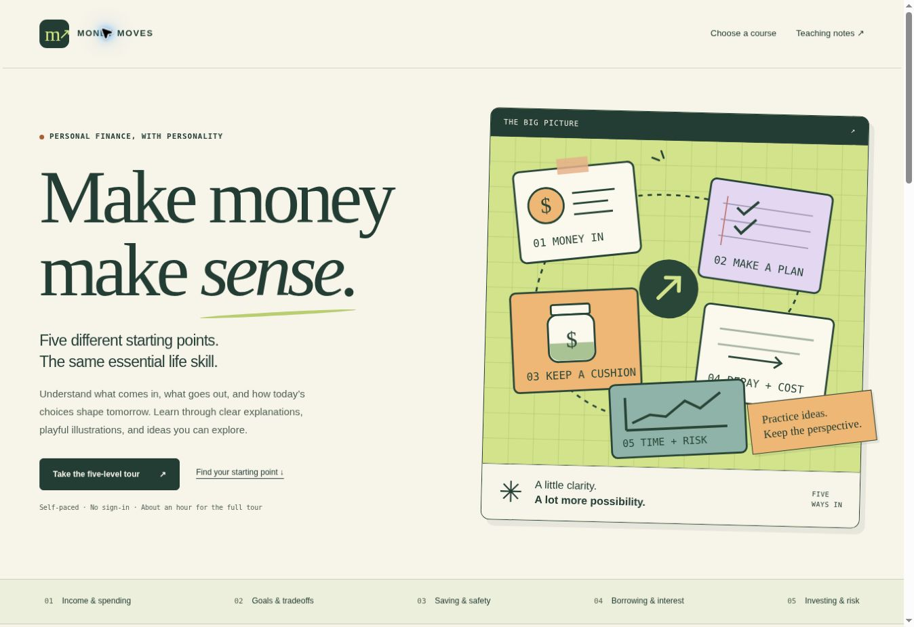

# Money Moves

Five independently editable, illustrated introductions to personal finance, created for Karen Strouse’s **ENG6803IteratingPersonalFinance** assignment.

Money Moves teaches connected concepts through explanations, everyday examples, interactive illustrations, chapter glossaries, and a final recap. Version 4 adds optional five-idea summaries and five-question knowledge checks tailored to each audience, retaining the friendlier teaching voice, original italic comments, and Version 3 playback. It is an introduction rather than a comprehensive curriculum or a personalized financial plan.

## Open the project

- Published GitHub Pages address: https://kgsucf.github.io/ENG6803IteratingPersonalFinance/
- Open `index.html` on a web server to choose one course or start the serial five-course tour.
- Estimated time: 8–12 minutes for the child course; 10–15 minutes for each other course. Optional quizzes add an estimated 2–4 minutes per level. These are editorial estimates; no learner timing study has been performed.

## Preserved iterations

- **Latest working version:** https://kgsucf.github.io/ENG6803IteratingPersonalFinance/
- **All saved versions:** https://kgsucf.github.io/ENG6803IteratingPersonalFinance/iterations/
- **Fixed Iteration 01:** https://kgsucf.github.io/ENG6803IteratingPersonalFinance/iterations/iteration-01/
- **Fixed Iteration 02:** https://kgsucf.github.io/ENG6803IteratingPersonalFinance/iterations/iteration-02/
- **Fixed Iteration 03:** https://kgsucf.github.io/ENG6803IteratingPersonalFinance/iterations/iteration-03/
- **Fixed Iteration 04:** https://kgsucf.github.io/ENG6803IteratingPersonalFinance/iterations/iteration-04/

Each saved iteration has its own complete runtime files and browser-storage namespace. Future edits to the root app do not change those files or overwrite the saved version’s progress. Use a numbered iteration URL when citing the assignment. `AGENTS.md` records the rule that previously saved iterations must stay unchanged; `npm test` checks their recorded file hashes.

The snapshot command creates a new folder and refuses an existing iteration number. See [the version-preservation workflow](docs/iterations.md). This is a publication and record-keeping change; the learning content of Iteration 01 is preserved.

## The five independent folders

| Folder | Audience | Learning environment |
| --- | --- | --- |
| `child/` | Child | The Pocket-Money Club: illustrated clubhouse |
| `teen/` | Teen | The Money Group Chat: phone and chat environment |
| `college/` | College student | Campus Cashflow: campus notebook |
| `post-college/` | Post-college student | The Real-Life Money Manual: apartment and household |
| `expert/` | Expert | The Assumption Lab: analysis dashboard |

Every folder has its **own** `index.html`, `content.json`, `lesson.js`, `quiz.js`, `model.js`, `style.css`, and `scene.svg`. No course imports another course’s content, style, engine, or calculations. The root hub and sources page are shared entrance/reference pages. Each course can be changed separately while keeping its folder and URL identity. The favicon and source/home links use the root; core teaching and models live entirely within the course folder.

To revise one course, edit only its `content.json`, `style.css`, illustration, or JavaScript as needed. The initial engines and models are intentionally duplicated to preserve independent editing. No generator or build step is required or used for deployment.

## What every course covers

1. Income, expenses, and money flow.
2. Budgets, priorities, goals, and opportunity cost.
3. Saving, emergency reserves, and resilience.
4. Borrowing, interest, and repayment.
5. Investing, compounding, time, and risk.

Depth, examples, humor, and vocabulary vary by audience. The college course includes a bill-date cash-flow illustration. The expert course includes controls for fees, inflation, gross return, and horizon. The child course uses a fixed-total borrowing example instead of APR arithmetic. Full sources, formulas, and exclusions appear in `sources.html` and beside each illustration.

## Local preview

From the repository folder:

```sh
python -m http.server 8000
```

Then open http://localhost:8000/. Use a web server rather than double-clicking HTML: the courses load their own JSON content. Deployment needs no Python, Node, dependencies, or build step; it serves plain HTML/CSS/JavaScript/SVG/JSON.

## Tests

Requires Node 20 or newer; no dependency installation:

```sh
npm test
```

Tests cover conservation of money, zero-saving and debt boundaries, interest repayment, timing gaps, inflation/fee arithmetic, lesson integrity, and local HTML links at a GitHub Pages project subpath. See `docs/iteration-01.md` for the first-version record and verification limits.

## GitHub Pages

Use **Settings → Pages → Deploy from a branch → main → /(root)**. The root `.nojekyll` file serves this as a static site. All asset links are relative so that course subfolders work at the project URL. GitHub may take a few minutes to publish a commit.

## Browser storage

Each course uses a separate `money-moves:v1:<folder>` local-storage key. Stored data consists of chapter visits, last chapter, self-marked completion, an optional reminder, optional learning notes, and update/completion timestamps. Visits and completion are not mastery assessments. No account, analytics, advertising, or external font service is included. Quiz answers and scores remain in page memory, are not exported or saved, and reset on leaving the recap or reloading. A learner can download or clear this project’s notes/progress from the hub. Blocked storage does not prevent lesson use.

## Assignment record

`docs/iteration-01.md` records the delivered baseline, requirements, and checks. `docs/iteration-02.md` records the requested friendlier teaching voice and its verification. `docs/iteration-04.md` records the optional summaries and knowledge checks. Proposed improvements are intentionally left to Karen; no AI-generated improvement list or user-testing results have been added.

## Published first iteration


